# Gradient Lab

An interactive companion to **COMP 4211 Machine Learning, Lectures 2–5**: linear regression and classification (L2), model selection (L3), neural networks from the perceptron to backprop and MLPs (L4), and convolutional networks (L5). You drag points, step learning rules and train small networks, and every number on the page is recomputed live from what you see.

**▶ Live demo: https://ml-visual.joshrkhoo.com** (also at https://ml-visual-beta.vercel.app)

It's one HTML file with no install. Open `index.html` in a browser, or use the link above. Topics are listed by lecture in the sidebar (a drop-down menu on phones), with a search box and previous/next buttons. Each topic has its own link, e.g. `#backprop`.

---

## Demos

### 2.1 Fitting a line by gradient descent
Each weight vector **w** = [w₁, w₂] is a line on the left and a point on the TrainLoss surface on the right. Gradient descent walks downhill on the contours while the line swings into place. Push η past about 0.3 on the lecture's data and the steps overshoot and diverge. Drag the data or the point on the surface.

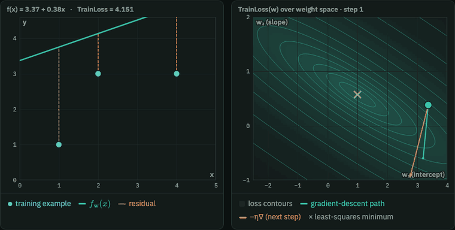

### 2.2 Score, margin and the hinge loss
Drag the tip of **w**: the boundary w·φ(x) = 0 stays perpendicular to it, and the dashed lines mark margin ±1. The right panel places every example at its margin on the zero-one, hinge and logistic losses, which shows why the flat zero-one loss gives gradient descent nothing to follow.

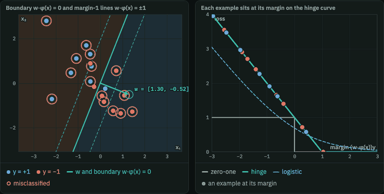

### 3.1 Overfitting and the bias–variance tradeoff
Polynomials of degree 0–12 fitted to noisy samples of sin 2πx. The faint curves are fits to other training sets, so their spread is the variance. Training error keeps falling with degree while testing error turns back up, and the bias² and variance curves cross near the sweet spot.

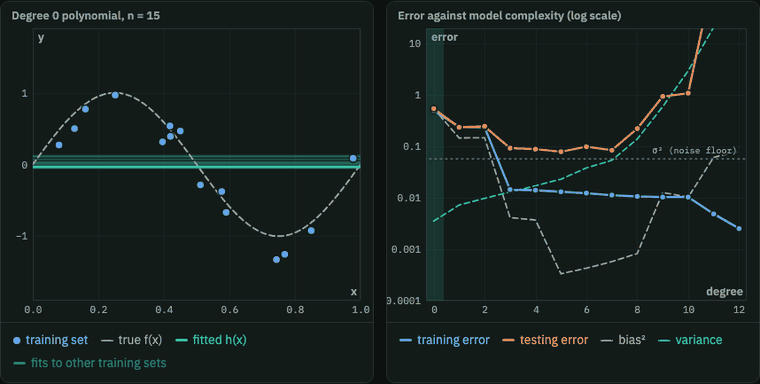

### 3.2 k-fold cross-validation
The fold strip shows which examples each round holds out. Click a round to see its fit. The CV error (mean over folds) picks a degree, compared against the error on fresh test data. There is a one-click leave-one-out mode.

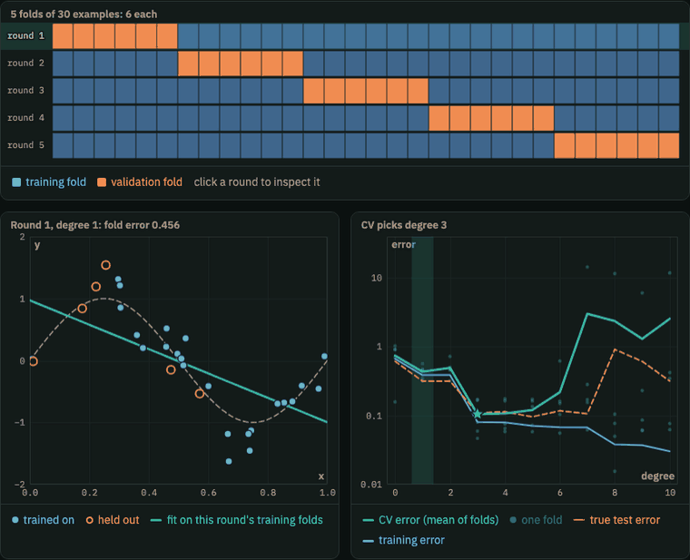

### 4.1 The perceptron learning rule
The lecture's apples example, one example at a time. Mistakes move the weights by αI(T − O), and the run ends at **w** = (1, −3, 4) after 12 iterations, matching the trace in the slides. Switch to random separable or non-separable data to watch it converge or never settle.

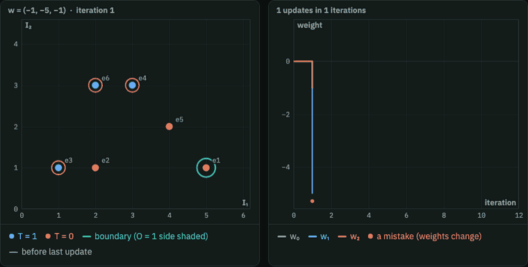

### 4.2 AND, OR, NOT, and why XOR needs a hidden unit
A single perceptron's line over the four Boolean inputs, set by hand or learned by the rule. XOR never gets all four right. On the right is the lecture's two-layer XOR network: click a corner to trace its activations through the hidden AND unit.

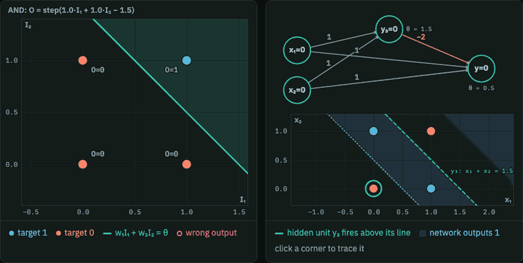

### 4.3 Learning rate, batch GD and SGD
An Adaline's error surface is a bowl. Batch GD, SGD (one example) and mini-batch run side by side from the same start. The panel reports λmax of the Hessian and the 2/λmax limit beyond which batch GD diverges. You can also switch on a decaying learning rate.

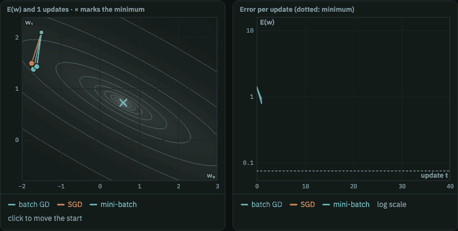

### 4.4 Activation functions and their gradients
Step, sign, sigmoid, tanh and ReLU with their derivatives, read off at any net input. On the right is one hidden unit's response over the input plane: a sigmoid unit lights up a whole half-plane, while a Gaussian RBF unit responds only near its centre.

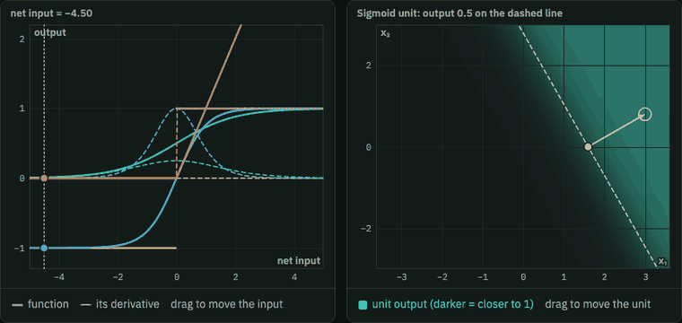

### 4.5 Backpropagation on a computation graph
Step through the forward pass, then the backward pass, node by node. Each step shows "[local gradient] × [upstream gradient]". There are four graphs: the lecture's f = (x + y)z, the sigmoid neuron (also collapsible into one σ gate), add/max/mul gate patterns, and a branching graph where gradients add. Inputs are editable.

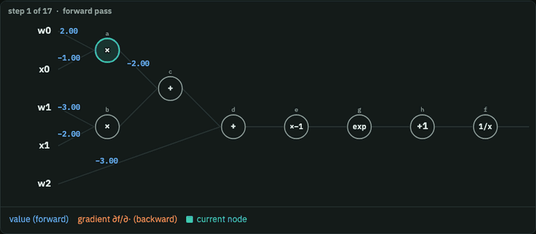

### 4.6 Momentum and local minima
An error surface with several basins. Plain gradient descent and momentum start from the same point. Plain GD stalls in a local minimum while momentum carries past the ridge into the global one. "20 random restarts" counts how often each method finds the global minimum.

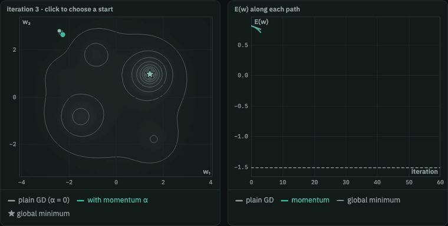

### 4.7 Training an MLP
A small MLP trained in the browser by backprop with momentum, in the style of TensorFlow Playground. The data sets are XOR, circle, moons, spiral and linear. You choose sigmoid, tanh or ReLU hidden units and one or two hidden layers. Each node in the diagram shows its own response map, and the dashed lines show the first-layer units' boundaries.

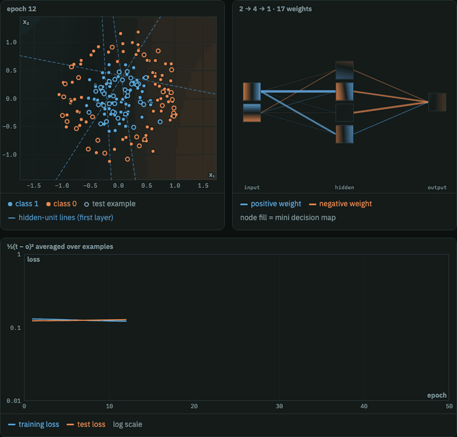

### 4.8 Universal approximation
One hidden layer of sigmoids (or ReLUs) with output weights fitted by least squares. Each unit's scaled contribution is drawn faintly, and the right panel shows the worst-case error shrinking as hidden units are added.

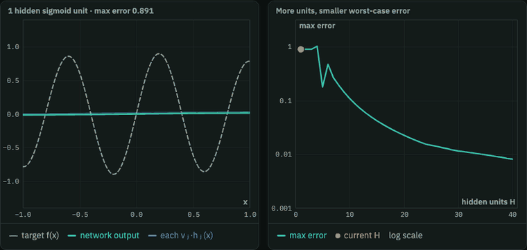

### 5.1 Convolution: flip, slide, multiply, add
A signal, the kernel flipped and shifted to position m, and the output building up as m slides. The full sum is written out for the current m. Untick the flip to get cross-correlation, which only differs for asymmetric kernels like the decay and difference kernels.

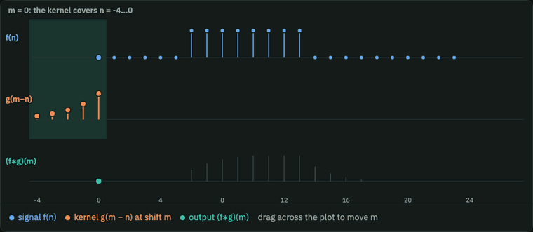

### 5.2 Image filters
3×3 kernels on a 28×28 digit: box blur, centre-weighted average, sharpen, Sobel x/y and Laplacian. Every cell of the kernel is editable. Hover an output pixel to see its receptive field and the sum that produced it, and draw on the input to try your own strokes.

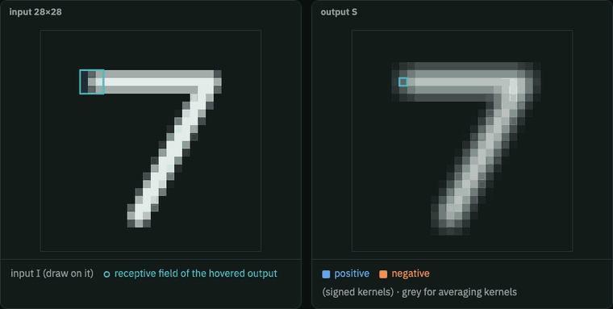

### 5.3 Padding and stride
The kernel window slides over a zero-padded input while the output map fills in. The output size ⌊(n + 2p − k)/s⌋ + 1 updates with the controls. A bar chart shows a 32×32 input shrinking through six such layers, compared with no padding and stride 1.

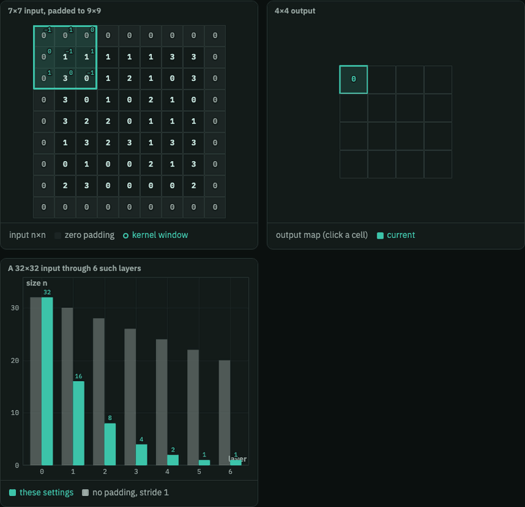

### 5.4 Max pooling and small shifts
Shift a feature map by one pixel and compare the pooled maps: cells outlined green are unchanged, red ones changed. Max pooling absorbs most small shifts. Average pooling absorbs fewer.

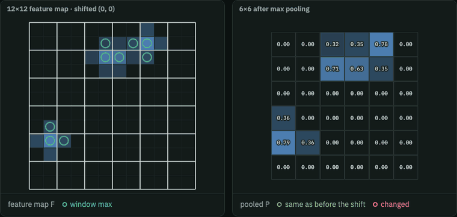

### 5.5 Receptive fields and parameter sharing
Stacked 1D conv layers: click a top unit to light up every unit feeding it, and watch the receptive field grow with depth, kernel size and stride. The right panel compares parameter counts for fully connected, locally connected and convolutional layers on a log scale.

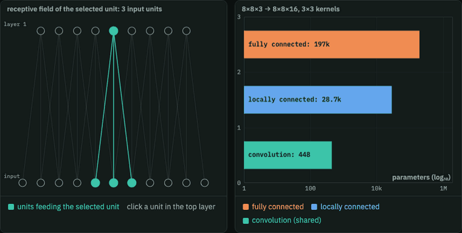

---

## Editing

The page source is split across `parts/` (styles, HTML, then one script file per lecture group). Edit those and run `./build.sh` to regenerate `index.html` (the deployed page) and `lab.html` (the same page without the document wrapper). To add a lecture, add its panels and a row in the `CHAPS` array in `parts/7-l5.js`.

Deployed on Vercel from the CLI:

```sh
vercel deploy --prod --yes --scope joshrkhoo1
```

Built from the COMP 4211 lecture slides. Random data comes from seeded generators, so "New" buttons change the seed.
